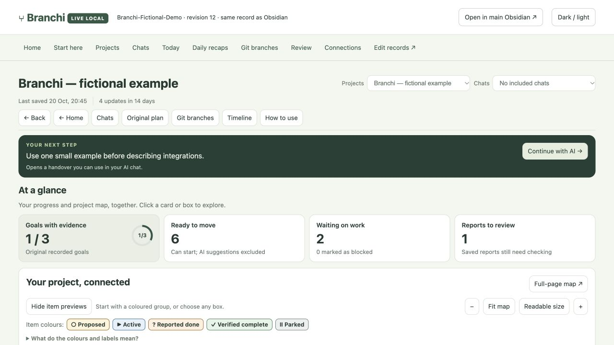
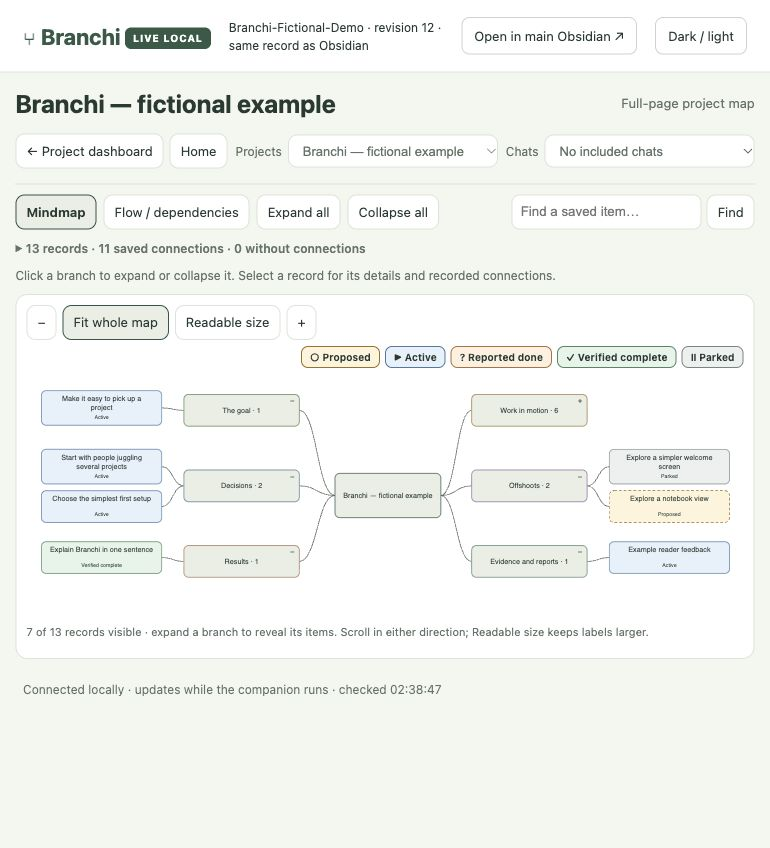
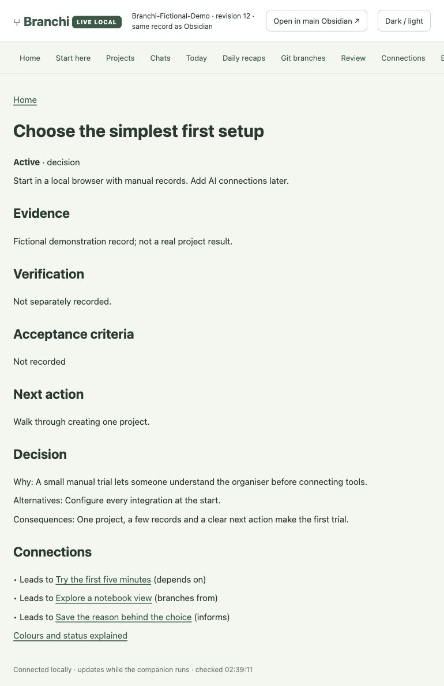

# Branchi

Branchi helps you pick up a project without starting from scratch. It keeps your original goal, saved conversations, decisions, useful links and next steps together in a visual map.

Use it when your work stretches across several chats, you keep exploring different ideas, or you need to return after a break. You can add records by hand, or connect supported AI tools to save useful updates.

## See Branchi in action

These screenshots use **Branchi — fictional example**, a made-up project about planning Branchi itself. Every goal, decision, result and progress count is sample data. No real user projects or captured conversations are shown.

**1. Pick up where you left off.** The overview brings together the next action, saved progress and work that needs attention.



**2. See how the work connects.** Explore the goal, decisions, results and offshoots. The work branch is collapsed here; open it to reveal its tasks.



**3. Remember why you chose something.** A decision keeps its reasoning, alternatives, next action and related work together.



[How the example images were made](docs/images/README.md) · [Download the fictional example record](examples/branchi-demo.json)

## What could I use it for?

| You want to… | Branchi helps you keep… |
| --- | --- |
| Plan a move or room makeover | Requirements, options, decisions and the next job |
| Manage job applications | Role requirements, document links and follow-up tasks |
| Learn something over several sessions | Questions, practice tasks, explanations and where to continue |
| Build a craft project, prototype or app | Design choices, files, dependencies and actual test results |
| Research a purchase or other decision | Requirements, sources, alternatives and reasons for your choice |
| Develop a story, guide or business idea | Drafts, feedback, offshoots and next steps |

These are example uses, not claims of completed work or guaranteed results.

## Start here — no technical background needed

**Already installed?** Open your local workspace, choose a project and read its next action. In the browser, choose **Start here** for examples and help, or **Edit records** to create a project and add items. In Obsidian, open Home → **Start here**. For a fresh setup, begin with the browser and manual records; Obsidian and AI connections can be added later.

[Read the beginner guide: setup choices, your first five minutes and prompts to copy](docs/getting-started.md).

A useful first project could be: **“Plan my room makeover within my budget.”** Save your requirements, compare two options, record your choice and leave one clear next action. When you return, the project dashboard and handover show the saved context.

**What is automatic?** Maps and reading pages are generated from saved records while the local companion runs. Saving AI chat updates needs a supported connection and permission for the specific chat. Optional AI mapping proposes tasks and decisions; saved reports and proposals still need review. Basic manual use needs no AI account or model API key.

<details>
<summary>Existing Brancha installations</summary>

Previously called Brancha. Existing installations continue to use the `brancha` configuration directory, `brancha.json`, plugin IDs and integration commands for compatibility; no vault migration is required.

</details>

## Technical setup and integration details

**Automatic mapping is the main workflow:** work in an enabled chat → supported capture → Luna decisions/tasks/branches → source-linked Obsidian maps. Twice-daily incremental High catch-up is the safety net; the skill is the manual fallback. [Set up automatic mapping](docs/automatic-mapping.md). Local Codex is automatic; GPT/Claude coverage depends on a tested client integration.

Keep the thread across AI projects: goals, decisions, branches, evidence, next steps and a visual map you can return to.

Obsidian is the primary project workspace. Branchi generates a dashboard, a Pele mindmap, evidence notes and reusable templates for every project; its local browser is a companion view of the same record.

Branchi is a local Node.js companion, browser workspace and portable skill. It renders diagrams with [Pele](https://pele.run/) and generates linked notes, project maps, a Canvas overview, a Bases table and resume briefs for Obsidian.

## Desktop first

Use Branchi alongside local Codex work and Obsidian. No browser extension is required for that workflow. Run `npm run desktop-hook` for local-only ChatGPT Work/Codex hooks, then review and trust their exact definitions; ordinary Chat mode currently has explicit connector checkpoints, not a verified passive listener. [Desktop setup and exact coverage](docs/desktop-workflow.md). Web capture and ChatGPT Sites are optional entry points.

## One live workspace

Open the configured Obsidian vault or http://127.0.0.1:51207/ for the same live project/chat dashboards, maps, timelines, saved sources and recaps. The browser now shares the Obsidian renderer and generated data; its record editor is at `/editor`. [View parity and boundaries](docs/live-workspace.md).

## Entry points

- **Portable Local MCP:** shared resume/checkpoint tools for compatible AI clients, using the local record without a cloud service or Codex session folder.
- **Checkpoint CLI:** a versioned receipt format for trusted hooks, test tools and other integrations.
- **Codex Local:** automatic local completion capture, the browser map and live generated Obsidian views.
- **Branchi Connect for ChatGPT:** a private cloud MCP service and skill for resuming projects and saving checkpoints during an activated task. It stays available while the Mac is off; it cannot passively watch every ChatGPT chat.

An optional approved bridge appends new ChatGPT checkpoints to the local map and Obsidian. Local Codex captures stay local. See [ChatGPT setup and connection boundaries](cloud/README.md).

In the app, **Use with ChatGPT** explains both entry points and gives you a starter for the selected project. Activate Branchi in that ChatGPT task, then save a first checkpoint to verify the connection. The local capture bar reports the cloud bridge separately from Codex capture.

## Choose your reading surface

Setup offers **Obsidian**, **localhost** or **both**. Use `--view obsidian`, `--view localhost` or `--view both` explicitly; interactive setup asks. Obsidian-only does not open a localhost port. Localhost-only needs no Obsidian installation. Both views share one record and renderer. Existing configurations are preserved; change an existing choice with `npm run views -- both` and restart the companion. [Setup choices and limits](docs/reading-surfaces.md).

All generated pages inherit a shared scoped style. Obsidian supplies its own theme colours; standalone browser pages use neutral charcoal/light surfaces and a purple accent. The generated **How Branchi works** map links capture, storage, mapping, review, page generation and resume, alongside an inventory of automatic outputs.

## Quick start

Requires Git and Node.js 22+. Quick-start prepares both reading surfaces, installs the activation skill and starts the companion; use `npm run quickstart -- --background` for macOS login startup. Keep the foreground terminal open on Windows/Linux. [Complete another-computer guide](docs/another-computer.md).

Codex session files are needed only for its optional automatic capture adapter. Obsidian is optional. No packages, model API keys or paid API requests are required by the capture adapter.

```sh
git clone https://github.com/fuzzwin/branchi.git
cd branchi
npm run quickstart
```

For other AI tools, run setup with `--no-codex`. Then run `npm run doctor` to inspect the configuration. See [portable setup](docs/portable-setup.md) for MCP connection snippets and [checkpoint protocol](docs/checkpoint-protocol.md) for optional Harness²/ARTEMIS receipts.

Moving to a new Mac or PC? Follow [Branchi on another computer](docs/another-computer.md) for the Obsidian-first setup, bringing your real projects, ChatGPT activation and cross-computer limits.

Open http://127.0.0.1:51207. In Obsidian, open the configured vault folder (default `~/Documents/Branchi`) and then `Generated/START HERE.md` or `Generated/Dashboards/index.md`. `Generated/Brancha.canvas` provides a visual entrance to the same dashboards. Each project links to a clean dependency mindmap, with a compact editable Canvas and full evidence in linked notes.

Setup writes a private connection to `~/.config/brancha/config.json`. Choose another vault with `npm run setup -- --vault /absolute/path/to/vault`. Existing configs are preserved. A fresh installation starts with fictional examples; creating your first project or receiving the first automatic checkpoint starts your real workspace. Unmatched automatic captures appear in **Codex Inbox**.

## Project dashboards

### Luna conversation maps

Run `npm run mapper -- enable`, restart the companion, and inspect `npm run mapper -- status`. New completed local Codex turns can produce source-linked decision and branch proposals in project maps and Obsidian conversation pages. The mapper uses your signed-in Codex CLI, Low effort with bounded High escalation, and preserves original goals. See [setup, limits and evidence boundaries](docs/conversation-mapper.md).

Each project automatically receives a dashboard with original goals backed by evidence, ready work, unmet prerequisites, reports awaiting review, a 14-day activity chart, and recent decisions and sources. The central Pele mindmap groups the records; dependency arrows stay in a separate flow view. Dates follow the displayed local timezone. Counts describe saved records, not hours, AI spending or productivity.

Five view templates tailor check-in prompts: Everyday project, Build & ship, Make & test, Research & decide, and Career & applications. The suggested template is inferred from the project name; an explicit dashboard choice is saved separately from the original request. Template stages are prompts, not inferred progress. Obsidian receives Check-in, Decision and Evidence review templates to copy into personal Notes. Generated dashboards refresh after record changes and daily while the companion runs.

## Automatic capture

The default adapter watches local Codex session files. On first activation it records file offsets and starts at the end: it does **not** import historical chat content. Every few seconds it checks newly appended completion events and stores the final assistant response as an **unverified source checkpoint**.

- Exact configured session IDs take precedence over project directory routes.
- Unmatched chats go to Codex Inbox, rather than being guessed into a project.
- Each chat has one current source node; dated activity snapshots preserve earlier reports.
- Checkpoints never complete success criteria or verify physical/software outcomes automatically.
- Session/turn IDs prevent duplicate captures after restarts or when the optional hook is also used.
- Hidden reasoning, intermediate commentary and tool output are not stored in the workspace.
- Common credential formats are masked on a best-effort basis. Treat captured final responses as private data; redaction is not a guarantee that arbitrary confidential information has been removed.
- The app shows capture status, last checkpoint and a Pause/Resume control. Paused activity is skipped rather than imported later.

The adapter uses the observed `session_meta` and `event_msg/task_complete` JSONL format. Codex's transcript format is not a stable interface; a future version may require an adapter update. This version is tested against the locally observed Codex 0.154.0 completion format. This automatic watcher does not observe cloud chats, ChatGPT web conversations, Claude, Cursor or other AI tools. Branchi Connect provides explicit project checkpoints for ChatGPT through its optional cloud plugin.

The workspace has an 8 MB safety limit. If reached, capture reports an error and retains pending work in its private cursor queue. Export/archive old checkpoints before continuing. Local backups are retained; users should manage their disk usage.

## Route projects

Edit the private config, then restart the service:

```json
{
  "vault": "/absolute/path/to/Branchi",
  "sessionsDirectory": "/absolute/path/to/.codex/sessions",
  "port": 51207,
  "pollMs": 3000,
  "sessionProjects": {"a-codex-session-id": "a-brancha-project-id"},
  "directoryProjects": [{"directory": "/absolute/path/to/project", "projectId": "a-brancha-project-id"}]
}
```

Use exact chat routes for shared folders containing unrelated work. `node scripts/control.mjs route-session SESSION_ID PROJECT_ID` adds a validated route. Existing checkpoints stay where they were recorded.

## Obsidian and the skill

`brancha.json` in the vault is the shared record. The app, capture adapters, local MCP and skill use file locks and atomic saves. Transient file replacement locks are retried within a bounded window without deleting the previous destination. Obsidian views refresh about one second after a change; the browser checks about every two seconds and defers changes while a form is open. Stale concurrent saves are rejected.

- `Generated/` is regenerated. Do not store personal edits there.
- `Notes/` is for your manual Obsidian notes. These notes are preserved, but are not automatically parsed back into the project record.
- `.brancha/` contains local cursors, status and capture backups.
- Run `npm run obsidian-style` to install scoped map/record styling with backups, or copy `assets/obsidian/brancha-map.css` into the vault’s `.obsidian/snippets/` folder and enable it under Appearance → CSS snippets.

Copy `skills/brancha` into your tool's skill directory (for example `~/.agents/skills/brancha`) or install the manual plugin package. The skill reads the local connection and helps you resume projects, review reports, record actual evidence and map decisions. It is reusable instructions plus validated helpers; the service supplies automatic capture.

Try: “Use Branchi to resume this project” or “Review the latest captured checkpoint and update the verified project state.” Installing a skill does not grant blanket permission for external actions.

## Run at login on macOS

After setup, stop any manually running Branchi process, then run:

```sh
node scripts/login-service.mjs
```

This installs `~/Library/LaunchAgents/com.brancha.companion.plist` and starts the service. It uses the current Node executable and this checkout's path; reinstall if either moves. Logs are under `~/.config/brancha/logs/`. It runs while you are logged in and the Mac is awake, and catches up on recorded completion events after sleep.

Pause/resume without stopping the app:

```sh
node scripts/control.mjs pause
node scripts/control.mjs resume
node scripts/control.mjs status
```

To disable login startup: `launchctl bootout gui/$(id -u) ~/Library/LaunchAgents/com.brancha.companion.plist`, then remove that specific plist. Your vault remains intact.

Linux/Windows users can run `npm start` or configure their own service manager. Those startup paths have not been tested here.

## Optional Codex plugin and hook

`.codex-plugin/plugin.json` bundles the skill and a `Stop` hook for manual desktop installation. The hook uses the supported `last_assistant_message`, `session_id`, `turn_id` and `cwd` input fields and shares deduplication with the watcher. Configure `BRANCHA_CONFIG` for a non-default connection. `node` must be available in the hook environment.

Codex requires users to review and trust new non-managed hooks; use `/hooks` in the CLI. The package does not bypass that trust. The installed watcher is sufficient for automatic capture without installing the optional hook.

Plugins containing lifecycle hooks are for manual desktop distribution, not the public plugin directory. GitHub distribution is separate from an OpenAI directory listing. See [Codex hooks](https://learn.chatgpt.com/docs/hooks) and [plugin packaging](https://developers.openai.com/plugins/build/plugins).

## Local data and sharing

The service binds only to loopback and uses a per-start token plus origin checks for browser writes. It does not upload captured chats. The local app uses bundled assets and system font fallbacks; its capture adapter and local MCP server make no network calls. The separately configured cloud bridge makes authenticated network requests. A separately hosted browser copy is a snapshot and does not automatically sync with your local vault.

This repository contains reusable code and fictional examples. Keep private configs, vaults, actual project history, credentials and hosting metadata out of commits. The included `.gitignore` covers common runtime locations; review files before publishing your own fork.

## Development

```sh
npm test
```

Tests use fictional fixtures and cover portable setup, local MCP round trips, concurrent clients, status preservation, verification stages, dependency chains and reimports, temporary file locks, routing, no-history activation, final-only parsing, split UTF-8 writes, duplicates, lock conflicts, restart recovery, pause behaviour, credential masking, source history and Obsidian links. This is an early working prototype; it is not a universal screen or chat recorder.

MIT licensed. The bundled Pele 1.7.0 library is MIT licensed; its original licence and package integrity receipt are in `dist/vendor/`.

## Interactive Obsidian dashboards

Run `npm run obsidian-interactive` to install the bundled local plugin into your configured vault, then enable **Branchi Interactive** in Obsidian. Restart the companion after upgrading. Project bookmarks open dashboard cards and clickable Pele maps; portable notes remain linked as a fallback. [Setup and interaction guide](docs/obsidian-interactive.md).

## Home and bounded review (0.9.0)

Branchi Home lists projects and recent captured chats, with search, handovers and timelines. Dashboard and timeline Home buttons return there. Known chat names come from the local Codex name index when available, restricted to already captured IDs. `npm run reviewer -- enable` enables the separate Luna High review worker after the mapper is enabled and the companion restarts. Home’s Check now and the hourly desktop task use the same grounded, proposal-only updater and eight-call reviewer limit. [Workflow and limits](docs/hourly-review.md).


### Find work by chat

Obsidian Home now opens a chat overview from Recent chats. **All saved chats** searches captured chat titles, latest report excerpts, report headings and file links; each project also lists its captured chats. Overviews collect saved requests/results, explicitly source-linked outcomes, choices, artifacts and a chat timeline. Automatic capture runs after completed turns while the companion runs; it does not reconstruct uncaptured history or passively read cloud chats. See [Chat continuity](docs/chat-continuity.md).

Daily recaps update automatically; Claude Code hooks and a local ChatGPT/Claude browser capture adapter are available. [Daily recap and capture setup](docs/daily-recap-and-capture.md). Browser capture is optional; real-client delivery must be verified before claiming coverage.

Full-page maps: choose **Full-page map** on a project or chat dashboard for expandable branches, all-record dependency views, search, diagnostics and evidence links in both Obsidian and localhost. [Usage guide](docs/full-page-maps.md).
