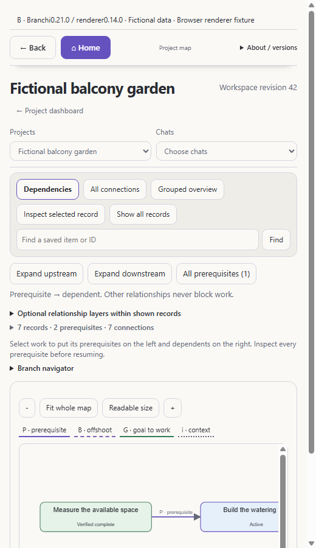

# Release image provenance

All new images use fictional sample projects created by
[`scripts/dashboard-demo.mjs`](../../scripts/dashboard-demo.mjs). No user
screenshots, project data, local paths, credentials or private Site URLs appear.

| Image | What it actually shows |
| --- | --- |
| `desktop-0.21-home.png` | Shared renderer 0.14.0, package 0.21.0, compact Home, 1440x900 |
| `desktop-0.21-dependencies.png` | Same renderer, prerequisite focus and inspector, 1440x900 |
| `desktop-0.21-narrow.png` | Same renderer, initial 520px pane with inspector deferred |
| `refresh-0.20-map-baseline.png` | Selected upstream refresh renderer 0.13.1, same fixture/core |
| `chatgpt-site-0.8.png` | Repository Worker 0.8.0 Site frontend, fictional in-memory R2 fixture |
| `two-setups.svg` | Source-authored architecture guide; planned exchange explicitly labelled |
| `dependency-key.svg` | Source-authored relationship guide; fictional records |

PNG files are real Chrome headless captures with a fresh temporary profile and
loopback-only fixture. They are neither native app captures nor a live cloud
deployment. No generated mock-up is presented as an implemented ChatGPT UI.

Start `node scripts/dashboard-demo.mjs`, open the printed Desktop/Site fixture
addresses and choose the view. The fixture's top label identifies A/B and source
versions. Its read-only adapter rejects writes. A baseline can be provided to
the exported `startDemo({rendererDirectory})` helper using the reviewed upstream
renderer files, without changing the current renderer.

The [sanitized browser report](release-0.21-browser-check.json) records viewport,
theme, reduced motion, CSS zoom, layout metrics and asserted interaction output.
Seven scripted checks are functional assertions, not human usability results.
Actual Chrome suspended-tab lifecycle and native 200% zoom remain untested;
browser capture consent has separate VM regressions.

Previous JPEG/PNG illustrations remain explicitly labelled as 0.18 examples in
the README for comparison. They are not evidence of the new UI.
