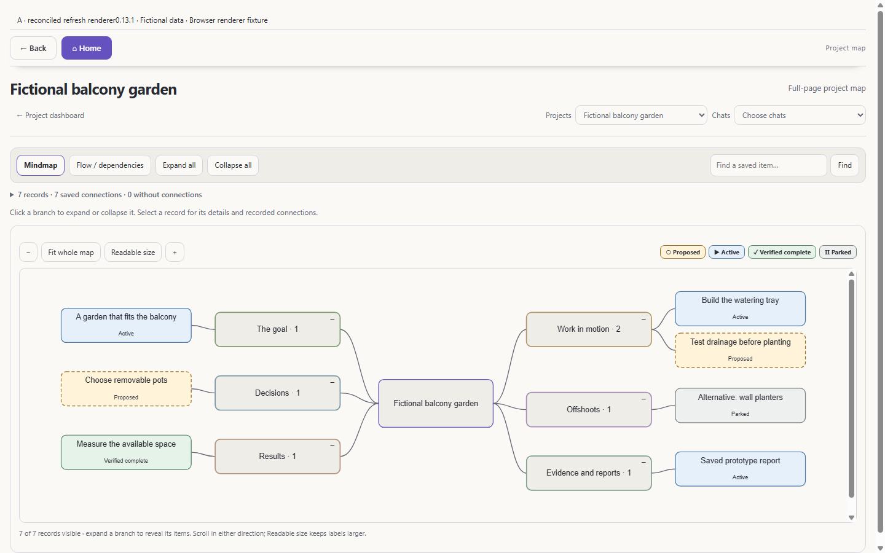
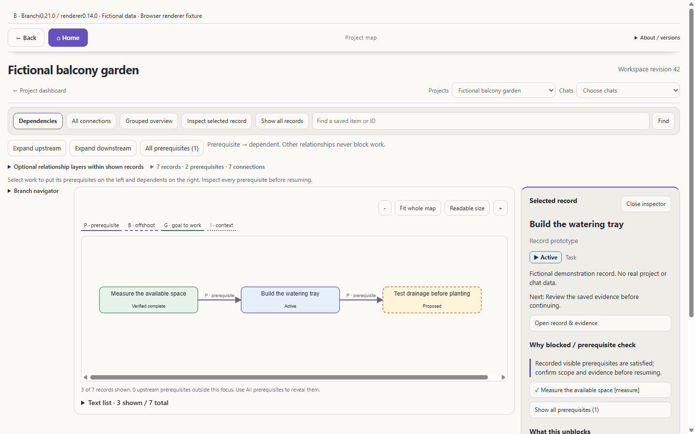

# Branchi 0.21.0: dependency focus and two clear setups

This development release combines the security corrections from 0.18.1 with
selected dashboard improvements from `codex/dashboard-map-refresh` at
`355a480dd5932e263c9064ae2babcc5639241b37`. It does not install an update on an
existing PC, enable AI/cloud settings or deploy a hosted service.

## Versions

| Component | Source version | Meaning |
| --- | --- | --- |
| Desktop package | 0.21.0 | Local source release |
| Shared dashboard renderer / Obsidian plugin | 0.14.0 | Home, project and map UI |
| Browser capture extension | 0.14.2 | Content-side consent-generation protocol |
| Repository cloud Worker | 0.8.0 | Separate Site source; four repository MCP tools |
| Workspace revision | Data-specific | Concurrency counter, never the app version |

An installed service and independently deployed cloud Site can differ from these
sources. About shows source and renderer versions, workspace revision, generated
time and saved-record time separately. Missing build commit/channel is reported
as unrecorded; this release does not invent deployment metadata.

## Dashboard changes

- Compact Home project list, optional cards, complete chat search and Show more.
  Wide panes place projects beside recent chats; narrow panes stack them.
- Reused refresh branch navigation, theme styling, uncapped Home panels,
  collapsed setup/analytics and project map beside the work queue.
- A dependency-only map now ranks and diagnoses `depends_on` edges. Context,
  goals and offshoots are optional, distinctly labelled layers. They never become
  scheduling prerequisites. All connections retains its earlier mixed layout.
- A selected task places prerequisites to its left and dependents to its right.
  Expand upstream/downstream or all prerequisites; shown/total counts disclose
  hidden records. Search includes stable IDs, including duplicate titles.
- The inspector explains blockers, downstream work and evidence. The branch
  navigator follows actual `branches_from` links; Grouped overview remains a
  category view. Neither implies alternative/OR prerequisites.
- Cross-project prerequisite closure, privacy-safe incomplete-scope markers and
  explicit scope completeness prevent a
  partial/legacy snapshot from claiming readiness. Unknown, parked, reported
  completion and unaccepted proposals do not count as completed prerequisites.
- Keyboard/text-list equivalents, visible focus, Escape/close focus restoration,
  narrow-pane drawer behavior and reduced-motion styling preserve navigation.
  Viewing, filtering and layout do not save or rewrite graph data.

## Automated comparison and limits

Baseline A is the selected refresh renderer (0.13.1) on the same security-fixed
core and fictional fixture. B is the new renderer (0.14.0). This is an automated
comparison, **not a human A/B experiment** or proof of faster task completion.





The browser matrix captured 55 real pages at 1280x800, 1440x900, 1920x1080 and a
520px split-pane width, with light/dark, reduced-motion and CSS zoom 2 cases.
Seven asserted interactions covered next-action selection, blocker explanation,
two-step prerequisite expansion, relation distinction, evidence route and
keyboard/drawer return. There were no JavaScript exceptions or page-wide
horizontal overflows; source data remained unchanged. Maps deliberately scroll
inside their own canvas at readable sizes.

These captures use the shared renderer in a browser adapter, **not native
Obsidian or Codex screenshots**. Evidence opening records the expected route in
a stub; actual Obsidian file navigation/back was not exercised. CSS zoom 2 is not
native browser 200% zoom. The 120-node / 471-link fixture checks finite layout,
counts and interactions; it does not establish a performance benchmark.

The cloud images run the real repository Site frontend against fictional,
read-only in-memory storage on loopback. They do not show a live deployment or
an in-chat ChatGPT card. [Image provenance](images/release-0.21-images.md) and
[machine-readable browser evidence](images/release-0.21-browser-check.json).

## Security and verification

Read [the security corrections and deployment constraints](security-0.18.1.md).
The security-only revision passed 187/187 local tests and 115 syntax checks.
Independent code review reproduced additional consent, browser and routing
defects; those corrections and fictional regressions are included here.
The reconciled release branch passes **210/210** local tests and 118 syntax
checks, plus the Worker build and emitted-source syntax check. Independent
map/Home verification passed 31/31. Security commit `7d1a306a77ebee378d88cafb486057c100a004f8` also passed
Windows, macOS and Linux in [run 39719918923](https://github.com/fuzzwin/branchi/actions/runs/39719918923).
The release branch matrix must be checked separately at its published commit.

Run without installing dependencies:

```sh
node --test --test-concurrency=1 tests/*.test.mjs
node cloud/build-site.mjs /path/to/temporary-build
node --check /path/to/temporary-build/worker/index.js
node scripts/dashboard-demo.mjs
```

The last command serves fictional Desktop and Site fixtures on a temporary
loopback port. It never loads configuration, private records or a real vault.
Stop it with Ctrl+C. It is a development preview, not a production launcher.

## Updating an adapted installation

1. Preserve the runtime, private configuration, canonical data, Notes and all
   adaptations in a local backup outside Git. Inventory modified/extra files.
2. Reconcile security source first in staging, including both core copies and
   standalone helper dependencies. Merge local adaptations instead of replacing
   them. Keep existing disabled AI/cloud and capture preferences.
3. Apply selected renderer/generator changes together and regenerate only derived
   views. Preserve personal notes, styles and unrelated settings. Keep a rollback
   copy of every changed generated/configuration file.
4. Verify a fictional vault and the full suite before an approved maintenance
   window. Stop all old canonical writers before changing lock protocols.
   Update browser/native helpers together and reactivate exact chats if used.
5. Verify the actual loaded version, active dashboard path, generated revision,
   source links and settings after an authorized restart. A Git checkout alone
   does not update the running process or Obsidian renderer.
6. Compare an existing cloud deployment's source/tool schemas separately. Do not
   overwrite an adapted deployment with this four-tool Worker or activate sync
   from these documents.

No merge, live installation, Obsidian installer update, restart or cloud
deployment is part of this release preparation.
