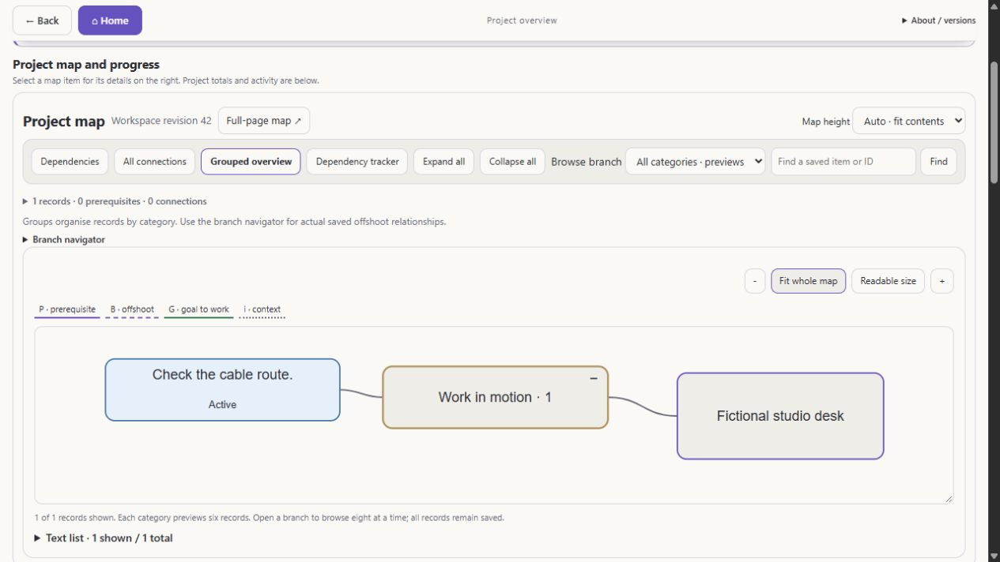
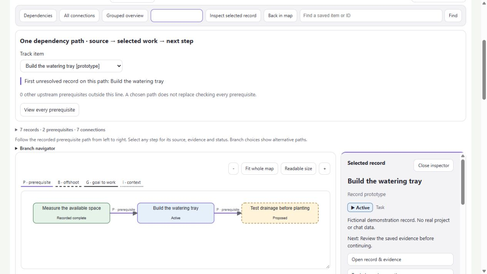

# Branchi 0.22.0: adaptive maps and dependency paths

Small maps now use the height their visible content needs. Large maps can grow
within the available screen space, then scroll while keeping labels readable.
Unused layout margins are removed; automatic fitting may enlarge labels by up
to 20%. Readable size, zoom and fixed 450/650/850 px heights remain available.
The same renderer serves localhost and Obsidian, and is included in cloud builds.

## Project workspace

- A dedicated, full-width map with a selected-record inspector on the right.
- Project totals, activity, timeline, tasks and chats underneath in sections that
  start expanded and retain the user's fold choices during refresh.
- Six-record category previews; open a category to browse eight records per page.
  Counts and search retain access to every saved record.
- Wrapped long filenames, with the full title in the tooltip and inspector.
- Dependency tracker: one horizontal prerequisite route, branch selectors at
  joins and forks, and the first unresolved record on the displayed path.

The tracker uses only recorded `depends_on` relationships. Context, category,
goal and offshoot links do not become prerequisites. Choosing a visual route
does not satisfy other prerequisites: their count remains visible and **View
every prerequisite** opens the complete upstream check. Cycles stop at a repeated
record. Source reports, unknown status and incomplete scope never establish
readiness or verified completion.

Windows Git observations allow up to three seconds per local read, rather than
one, so process-start overhead does not discard a valid branch snapshot. Reads
remain bounded and never request remote URLs, diffs, hooks or credentials.

## Fictional browser checks

These are browser captures of fictional data using the shared renderer, not
screenshots of a user's Obsidian vault or a live hosted workspace.





## Versions and installation

| Component | Version |
| --- | --- |
| Desktop source package | 0.22.0 |
| Shared renderer / Obsidian plugin | 0.15.0 |
| Repository cloud Worker | 0.9.0 |

The repository cloud Worker retains its four tools, authenticated storage and
existing export/bridge boundaries. Independently customised hosted services may
have different service versions and extra tools. A Git update does not itself
upgrade an installed PC or publish a hosted Site.

After updating an existing installation, refresh the renderer using its existing
Obsidian installation command and reload the plugin or vault. Preserve the
vault's configured prefix and unrelated themes, notes and bookmarks. Map width
rules apply only to generated Branchi views.

## Local checks

Run `npm test`. For an existing generated workspace, run:

```text
npm run maps:audit -- /absolute/path/to/config.json
```

The audit is read-only. It checks every project's record coverage, bounded branch
pages, text wrapping, node overlaps, finite paths and actual prerequisite edges.
It does not read chat transcripts or replace a browser/native visual check.

The tests and dashboard demo use fictional projects. Real vaults, conversations,
credentials, hosting identity and machine-specific configuration are excluded
from the release.
