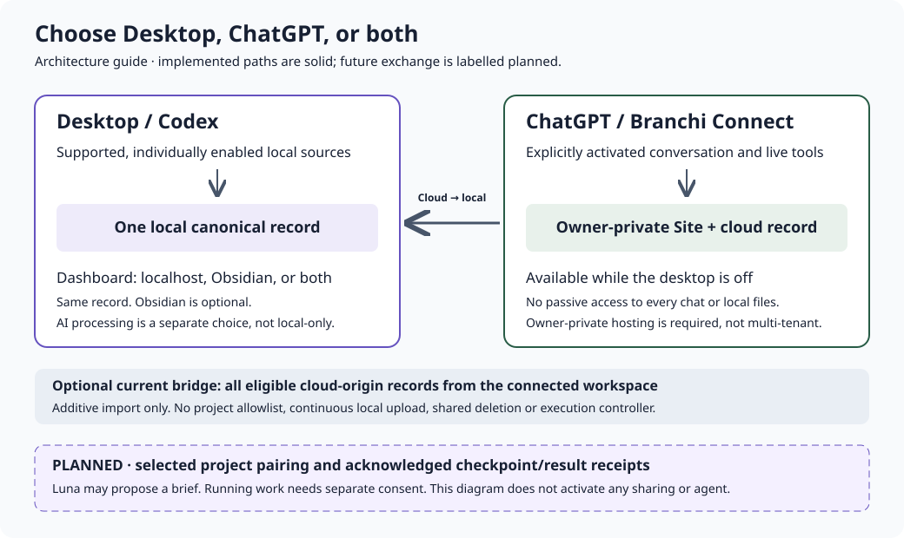

# Desktop, ChatGPT and the connection between them

Use either setup independently, or choose both. Desktop stores your local record
and offers localhost, Obsidian or both. ChatGPT uses a private hosted workspace
through Branchi Connect. They are separate stores and deployments.

This guide describes the source in the 0.21 development release. An installed
desktop, renderer and deployed cloud worker can each be older or adapted. Check
their actual versions before relying on a feature. Nothing here enables sharing,
model access, credentials, execution, monitoring or notifications automatically.



## Choose your setup

| Setup | Where you work | Where records live | Dashboard |
| --- | --- | --- | --- |
| Desktop | Local Codex and supported local integrations | Local `brancha.json` | Localhost, Obsidian, or both |
| ChatGPT | A conversation explicitly using Branchi Connect | Owner-private cloud workspace | Private Site and connected ChatGPT tools |
| Both | Each setup independently | Two separate records | Each keeps its own views |

### Desktop: first useful session

With Git and Node.js 22+ installed, a fresh setup with the browser view and AI
interpretation disabled is:

```sh
git clone https://github.com/fuzzwin/branchi.git
cd branchi
npm run setup -- --view localhost --no-ai
npm start
```

1. Open the displayed localhost address, create a project and retain the original
   request and success criteria.
2. Save a next action, a decision or an evidence-linked checkpoint manually.
3. If wanted, explicitly include one supported chat. The running companion saves
   its completed visible work; a skill alone is not a background listener.
4. Open the project, inspect its blockers and follow a source before resuming.

Choose `--view obsidian` or `--view both` for other reading surfaces. Obsidian is
optional; both views use one local record. Personal writing belongs in `Notes`,
outside regenerated pages. Existing setup/configuration is preserved. Change an
existing view using `npm run views -- MODE`, then restart the existing companion
at an appropriate time. See [reading surfaces](reading-surfaces.md),
[another computer](another-computer.md) and [desktop coverage](desktop-workflow.md).

**Local storage does not mean on-device AI inference.** Fresh setup enables the
mapper and reviewer unless `--no-ai` is supplied. Their signed-in Codex runner
processes selected visible text using the configured model service. Capture and
interpretation are separate choices; individually enabled chats, runner access,
account limits and connectivity still apply. Existing disabled settings are not
changed by this release. See [Luna's runtime and limits](conversation-mapper.md).

After upgrading browser capture and its native helper, legacy included chats
need **Disable, then Enable this exact chat** to obtain a fresh consent ticket.
Enable alone may retain a missing legacy ticket and capture will fail closed.
This does not delete saved records or authorize replay of earlier replies.

The companion must run for automatic capture and live updates. Saved records
remain on disk when it stops. It does not capture hidden reasoning or every
keystroke, and client coverage must be verified in the actual installation.

### ChatGPT: first useful session

1. Reuse the intended owner-private Site and its connected personal plugin. Follow
   [Branchi Connect setup](../cloud/README.md); hosting and sign-in are separate
   from importing skill instructions.
2. In ChatGPT, explicitly choose Branchi and ask it to list/resume a named project.
3. Save a meaningful checkpoint with the observed revision, evidence references
   and a concrete next action. A reported result does not verify acceptance.
4. Return to that project through a resume/status tool, or open its private Site.

This setup remains available while the PC is off. It does not obtain access to
local files, a Codex session, or every ChatGPT conversation. There is no need to
build another chat application inside the Site. See [using Branchi across
chats](chatgpt-usage.md).

**Owner-private hosting is a hard invariant.** The repository worker uses one R2
workspace object and a global revision, with an 8 MB workspace limit. It relies
on the trusted Sites authenticated-user header or the configured bridge secret;
it does not independently bind records to separate tenants. Do not expose it on
an unprotected origin or treat caller-supplied identity headers as authentication.
Multi-user hosting requires a separate ownership and isolation design. These
limits do not establish that an existing owner-private deployment is exposed.

### Both: current bridge scope

Use both independently. The optional current bridge fetches the connected cloud
workspace and copies **all eligible cloud-origin records** into the local record.
It has no per-project allowlist or pairing control. It appends missing eligible
projects, nodes, links and events; existing local records and edits are preserved.
Approve that actual whole-workspace scope before configuring persistent access.

The bridge is cloud-to-desktop only. It does not continuously upload local
captures, reconcile edits/deletions in both directions or execute work. An
optional one-time seed into an empty cloud workspace is a separate setup action.
Pausing local capture also defers cloud pulls; it does not prevent ChatGPT from
saving new cloud checkpoints or erase previously shared data. Catch-up resumes
when the configured companion is online. See the [bridge
contract](../cloud/README.md#optional-cloud-to-local-bridge).

## What is what?

| Term | Meaning and boundary |
| --- | --- |
| Project | The original goal/request, success criteria and related records |
| Goal | An intended outcome; its title or a report does not prove completion |
| Branch / offshoot | A saved `branches_from` origin-to-offshoot relationship; not an OR prerequisite |
| Dependency | A recorded `depends_on` prerequisite-to-dependent link; only these links block scheduling |
| Context / goal link | `informs` supplies context; `implements` connects a goal to work; neither is a prerequisite |
| Grouped overview | A category layout, not evidence of actual branch lineage |
| Checkpoint | A saved report/decision/next step with provenance; self-reports remain unverified |
| Evidence | A cited observation, artifact or test result that can be checked |
| Saved | Written to the named store; says nothing about delivery to the other setup |
| Synced / acknowledged | Delivery confirmed by the receiving store; ongoing two-way sync is planned |
| Software version | A package, plugin or cloud-worker build identifier |
| Workspace revision | A data concurrency counter; revision 171 is not app version 171 |

In the dependency map, select work, read **Why blocked**, reveal **All
prerequisites**, then inspect **What this unblocks**. Prerequisites appear on the
left and dependents on the right. Counts show how much remains outside a focused
view. Context loops do not create prerequisite-cycle warnings. **All connections**
keeps every relation type; **Grouped overview** keeps category browsing. The
branch navigator lists actual saved offshoot links. No recorded prerequisite is
not proof that none exists. Inspect record/evidence and return before resuming.

## Available versus planned

| Capability | Status |
| --- | --- |
| Local record and localhost/Obsidian/both choice | Implemented |
| Individually enabled supported capture and local MCP checkpoints | Implemented; verify real client delivery |
| Private ChatGPT resume/create/checkpoint tools | Implemented; deployment and account connection required |
| Additive whole-cloud-workspace bridge | Implemented; optional configuration and approval required |
| One-time seed into an empty cloud workspace | Implemented setup action, not outbound sync |
| Exact workspace/project pairing and selective exchange | Planned |
| Origin-owned immutable checkpoints and result receipts with acknowledgements | Planned round-trip MVP |
| Explicit ChatGPT-to-Codex execution handoff and return | Planned, separate execution consent required |
| Luna Sync triage and handoff summaries | Planned; not the existing mapper/reviewer |
| Dual-master edits/deletes, autonomous conflict resolution | Deferred until authority rules exist |
| New in-chat cards and subscribed result notifications | Deferred; not implemented Branchi features |

## Planned round trip: prove a small exchange first

1. Plan a named project in ChatGPT and save a cloud checkpoint.
2. Select an exact paired local workspace/project and inspect the outgoing payload.
3. Transfer context as an immutable, origin-owned receipt and show acknowledgement.
4. If separately authorised, accept a bounded execution handoff in a chosen Codex
   thread/repository, retaining task scope, input version and approval limits.
5. Save the local result, actual tests/failures, artifact references and next step.
6. Return the selected result receipt to the paired cloud project; retrieve it in
   ChatGPT. A local path is not a cloud attachment and needs an authorised transfer.

This first design is append-only: corrections use explicit `supersedes` events.
Each event needs stable origin/workspace/project identity, schema version,
provenance and a content hash. Write a durable outbox before sending and an
inbox/deduplication receipt before acknowledgement. Reusing an ID with different
content is an error. Local/cloud revisions are separate; show cursors and
acknowledged versions instead of treating counters or timestamps as interchangeable.

Use an outbound authenticated desktop connection. No public inbound desktop
port is needed. Retry transient failures with backoff; pause on auth/schema/access
failure. Recover offline queues without claiming delivery early. Inspect uncertain
execution outcomes before retrying a persistent job/run ID, so lost acknowledgements
cannot launch the same work twice. Defer shared edits and deletion until ownership,
conflict review, tombstones and offline resurrection rules are defined.

### Three responsibilities

**Sync Engine:** deterministic transport, validation, persistence, deduplication,
version checks, retries and acknowledgements. Basic delivery must not depend on AI.

**Luna Sync:** optional evidence-linked brief, triage and conflict proposals, cached
by source hash. It must not repeatedly summarise summaries, silently choose a
winner, change original scope, declare verified completion or grant permissions.
If unavailable, transport continues and interpretation is visibly pending.

**Codex Executor:** explicitly authorised work in a selected workspace, with a
durable job/thread identity and evidence-backed outcome. The official [Codex
SDK](https://learn.chatgpt.com/docs/codex-sdk) and [App
Server](https://learn.chatgpt.com/docs/app-server) supply programmatic interfaces;
Branchi does not yet implement this dispatcher. Runtime support, authentication,
approval enforcement and end-to-end delivery must be verified first.

Keep sharing context, receiving updates, executing work, transferring artifacts
and notifying conversations as separate controls. Default to selected compact
summaries and evidence references. Exclude credentials, hidden reasoning, raw
transcripts, unrelated notes and environment secrets. Redaction is not a guarantee;
imported text cannot expand authority. Stopping sharing and deleting elsewhere are
different actions.

## What can return to ChatGPT?

The minimal return path is a saved cloud result retrieved by a resume/status tool.
New UI or push notifications are unnecessary to prove that round trip.

OpenAI [plugin extensions](https://developers.openai.com/plugins/build/extensions)
and [MCP Events](https://developers.openai.com/plugins/build/mcp-events) offer
platform-specific interaction/subscription capabilities. Branchi has not implemented
the proposed controller or result subscription. Do not infer support for every
client/account, passive all-chat access, or completed user-visible delivery from
webhook receipt. Follow the platform's [plugin data
boundaries](https://developers.openai.com/plugins/plugin-guidelines).

## Versions and visible status

Compare repository/package version, renderer/plugin version, the running local
build and the separately deployed cloud build. Show workspace revision, saved
time and generation time separately. A newer repository does not update a running
process or hosted Site. The repository cloud schema currently exposes four tools;
an independently adapted deployment can differ and must be reconciled before any
deployment. Never blindly replace it.

The future exchange UI should distinguish Saved locally, Queued, Acknowledged,
Waiting for desktop, Ready to run, Running, Awaiting approval, Result available,
Conflict and Paused. Interpretation status is separate from delivery status.

## Challenger workflow: a bounded future layer

A lightweight assumption/alternative check can help any chat. Substantial work
can receive an independent evidence-first review; ongoing projects can maintain
an evidence/decision/artifact impact graph and generated indexes. Branchi provides
continuity building blocks, not universal enforcement, passive all-chat observation
or an implemented orchestration layer. This design does not activate an agent or
authorise execution. Prove the small receipt round trip before adding that layer.
